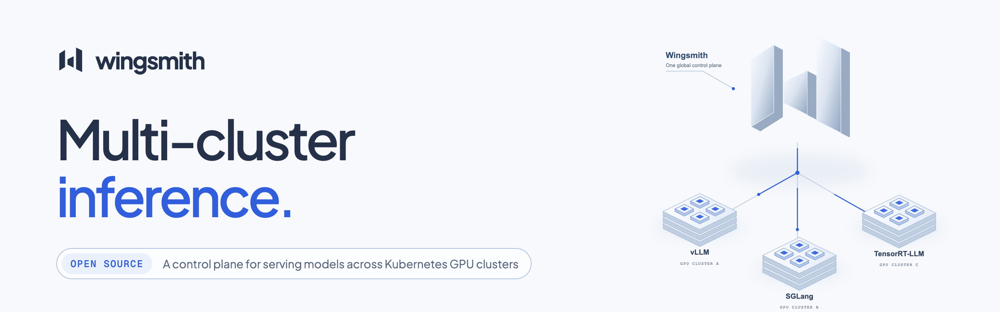

<a href="https://wingsmith.dev">
  <picture>
    <source media="(prefers-color-scheme: dark)" srcset="banner-dark.png">
    
  </picture>
</a>

**Wingsmith** is an open control plane for serving models across several Kubernetes GPU clusters. It enrolls your clusters, keeps a per-device inventory of them, places each model on one or more clusters, renders it there as an [NVIDIA Dynamo](https://github.com/ai-dynamo/dynamo) deployment with vLLM, SGLang or TensorRT-LLM as the engine, and routes OpenAI-compatible requests to it through its own gateway.

- **Two planes.** The control plane stores intent. Inference traffic never passes through it, and a running gateway keeps serving from its cached routing table if the plane goes away.
- **Outbound only.** Each cluster's operator and agent dial out. The plane holds no kubeconfigs and nothing dials into a cluster.
- **Per-device inventory.** DCGM identity and health, with NVLink, NVSwitch and PCIe topology.
- **Operations with a lifecycle.** Scale, pause and drain have progress, an actor, a reason and a failure mode.
- **Measurement built in.** API conformance against a reference provider, four load generators side by side, and request-path measurement without a GPU.

**Status:** pre-release. No tagged release, images or charts yet, and APIs and protocols can change. Licensed under Apache 2.0.

[Website](https://wingsmith.dev) · [Docs](https://docs.wingsmith.dev) · [Architecture](https://wingsmith.dev/architecture) · [Quickstart](https://wingsmith.dev/quickstart) · [Model directory](https://wingsmith.dev/models) · [Roadmap](https://wingsmith.dev/roadmap)

Built by [Aircloud](https://aircloud.dev).
